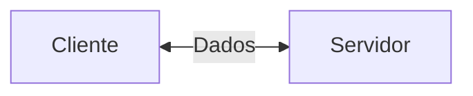
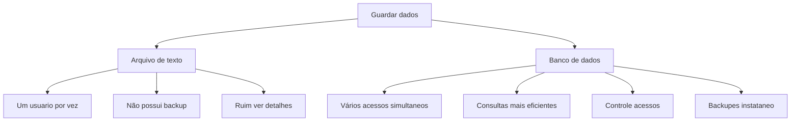
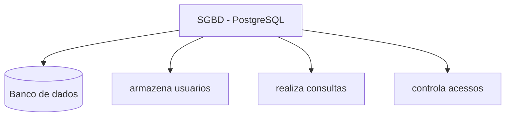

## Servidor de desenvolvimento

Será uma interface de desenvolvimento, utilizada para projetar aplicações e banco de dados.


---
## Servidor de arquivos educaional 
É um servidor para armazenar arquivos e facilitar na hora de realizar a transferência
>O endereço para o servidor é: `\\10.87.36.10`
>Credenciais de acesso: aluno em tudo


## Servidor pessoal 
O Moba será a interface para o meu servidor de desenvolvimento

>O acesso é via SSH
ip 192.168.10.75
username root
porta 2222

```bash
passwd
```
troca senha

```bash
htop
```
mastra recursos servidor linux

|recurso| Configuração|
|----|---------|
|processador| 2 cores|
|ram|512MB|
|armazenamento| 6GB|
|s.o| Ubuntu 26.04 lts|

- usa para deploy
- banco de dados
- xp mercado


## Banco de dados


---

## SGBD
sistema gerenciador de banco de dados

