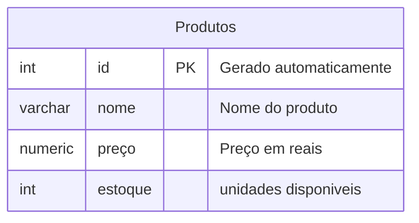

/24 todas as faixas do ip
/32 apenas o seu ip

DROP DATABASE (nome servidor); derruba o servidor
---


PK = primary key

para cria r tabela no postgres
```sql
CREATE TABLE produtos(
    id INT GENERATED ALWAYS AS IDENTITY PRIMARY KEY, 
    nome VARCHAR(50)NOT NULL,
    preco NUMERIC(10, 2) NOT NULL,
    estoque INT NOT NULL DEFAULT 0
);
```
varchar define o quanto de caracteres podem ter no nome
numeric o 10 limita numero casas pre virgula e o 2 o limite depois da virgula

inserir valores
```sql
INSERT INTO produtos(nome, preco, estoque) VALUES(
    'Iphone 17', '10000.00', '15'
);
```
```sql
SELECT * FROM produtos;
```
olha valores na tabela

```sql
 DELETE FROM produtos WHERE id = 1;
```
deleta dados se precisar