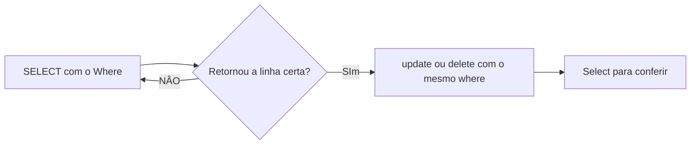
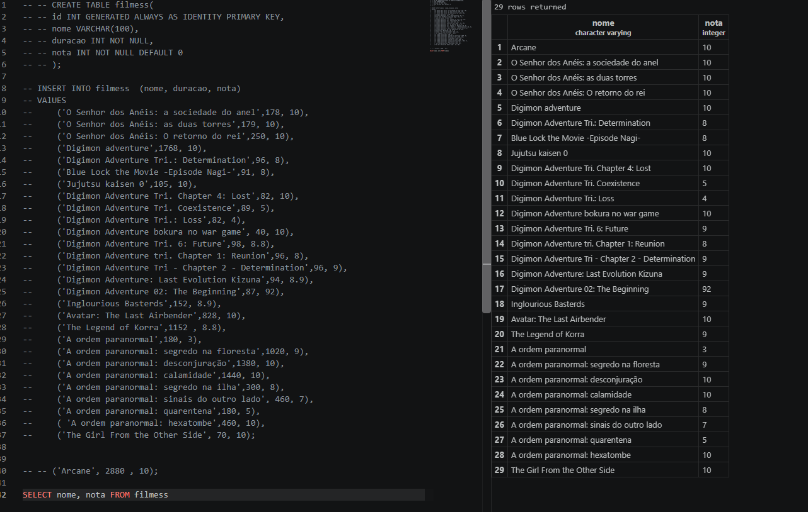
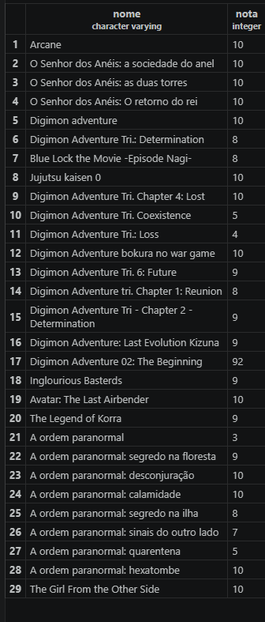
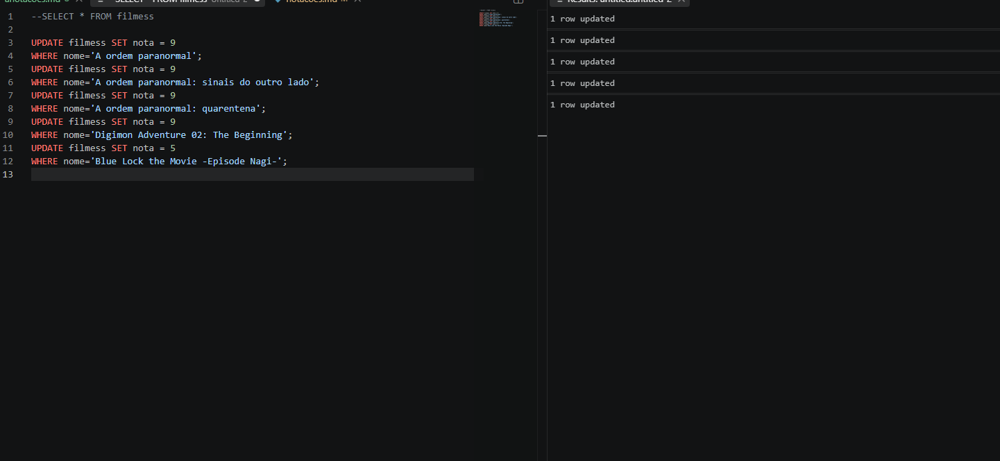
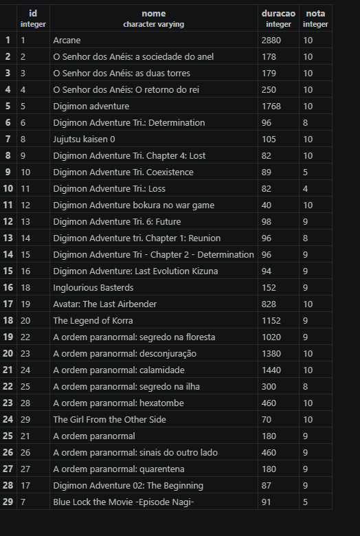
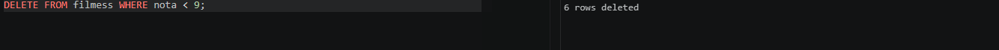
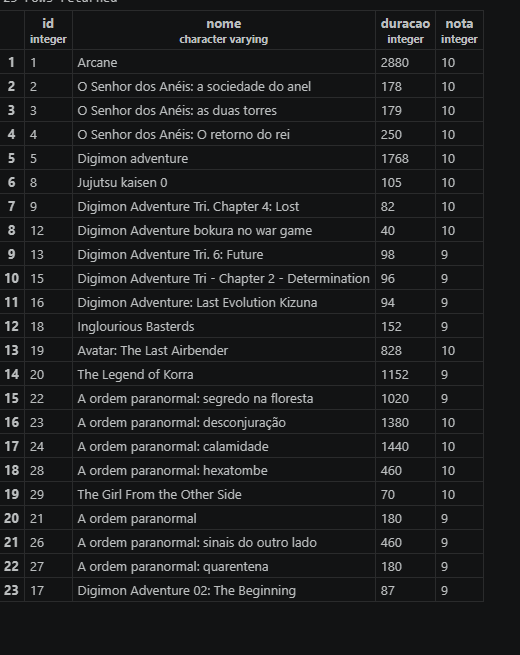

## Aula 05

Para filtrar colunas utilizamos o comando
```sql
SELECT nome, preco, FROM produtos;
```

```sql
SELECT * FROM produtos WHERE  estoque < 10;
```
para ordenar dados

```sql
SELECT nome,preco FROM produtos ORDER BY  preco DESC;
```

---
**UPDATE**
update ou delete sem `Where` afeta todas as linhas

Fluxo seguro (sempre):


Para update:
```sql
UPDATE produtos SET preco=150 WHERE nome='Iphone 17';
UPDATE produtos
SET estoque = estoque -3
WHERE id = 1;
```
---
para deletar 
```sql
DELETE FROM produtos WHERE nome='Iphone 17';
```
### atividade
atividade 

selecionando dados especificos


trocando notas 


deletando filmes 

