database criado 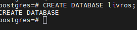

tabela criada 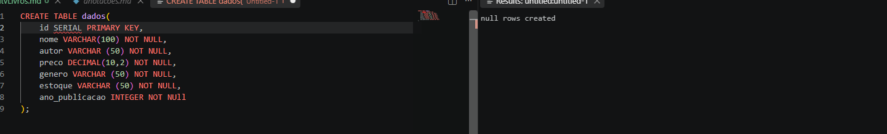

valores inseridos na tabela 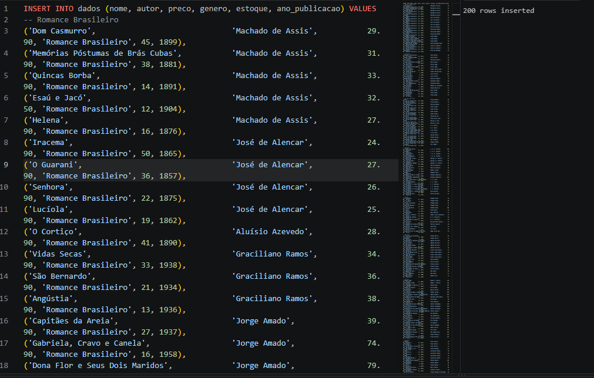

limitado a apenas 10 items 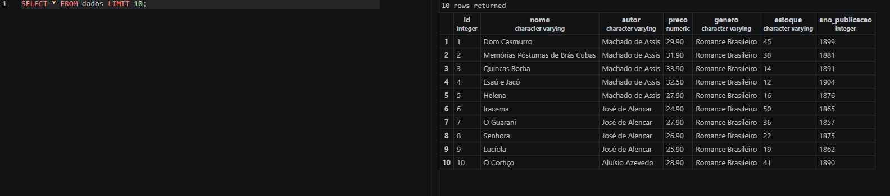

mostrando apenas nome, autor e preço 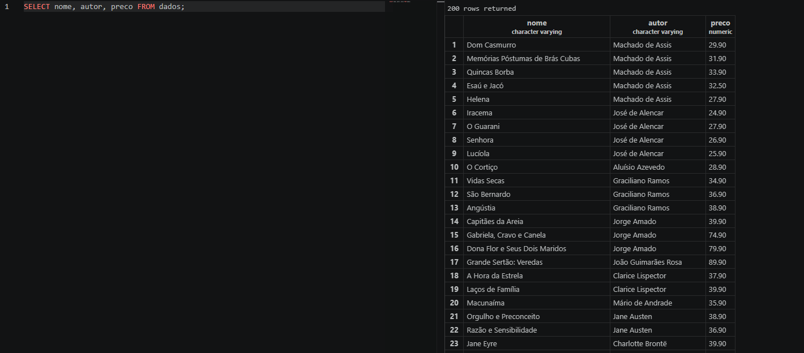

generos em ordem alfabetica 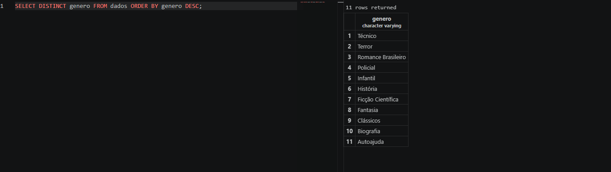

autores diferentes 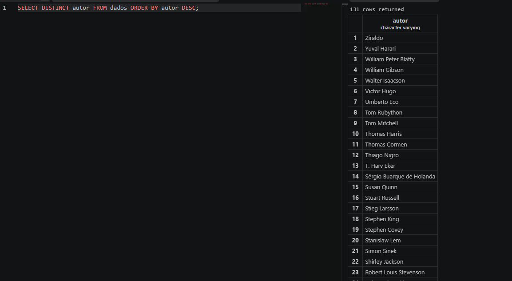

nome e preço dos mais caros 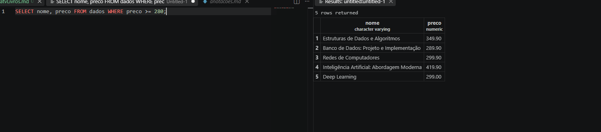

menor estoque 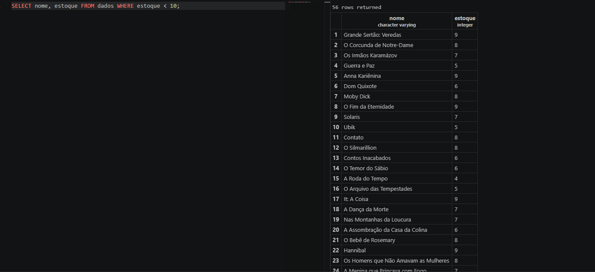

mostrando apenas livros técnicos 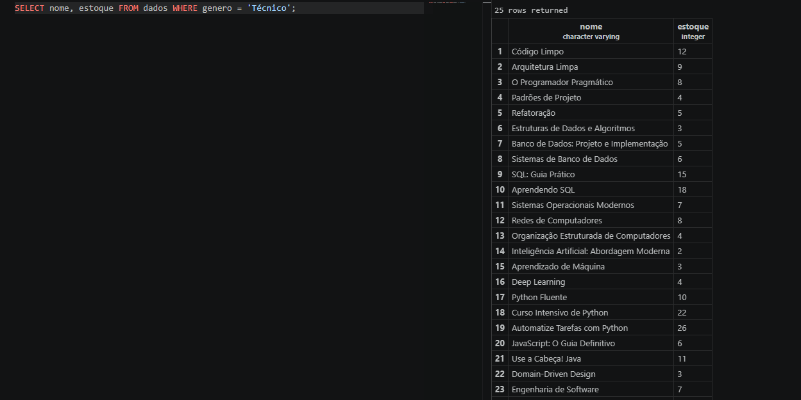

livros que custam mais de 200 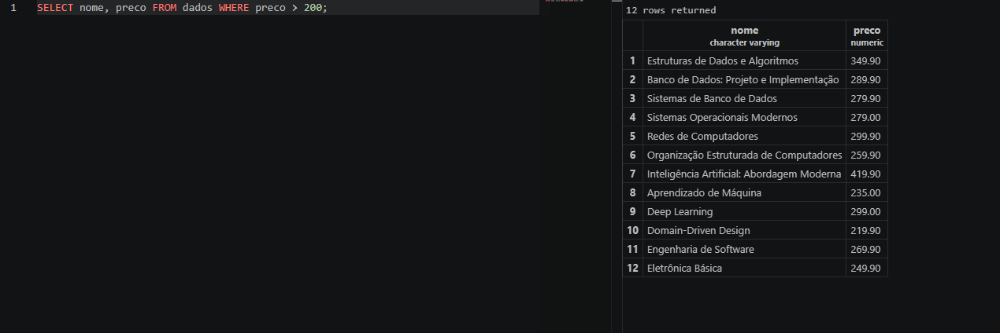

livros com preço entre 40 e 70 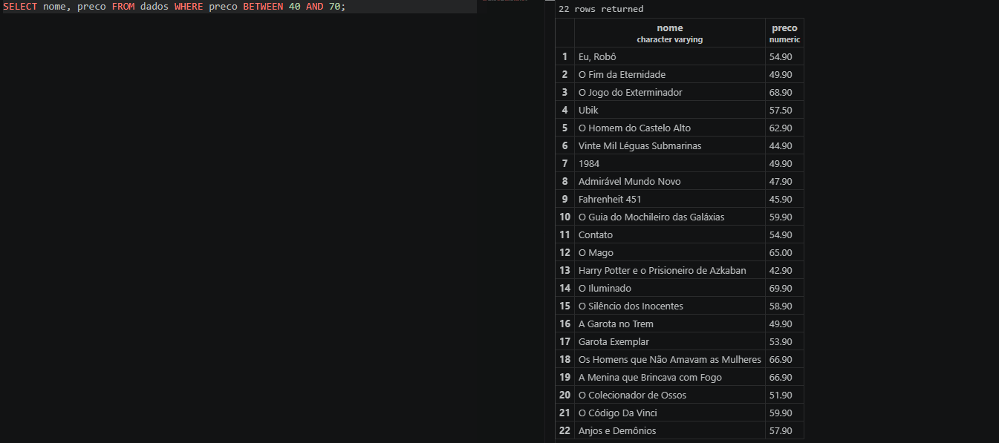

estoque baixissimos 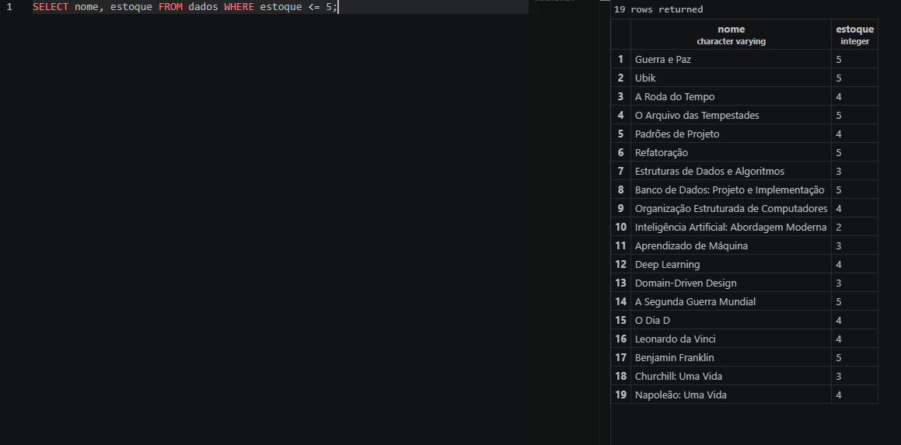

ano de publicação antes de 1900 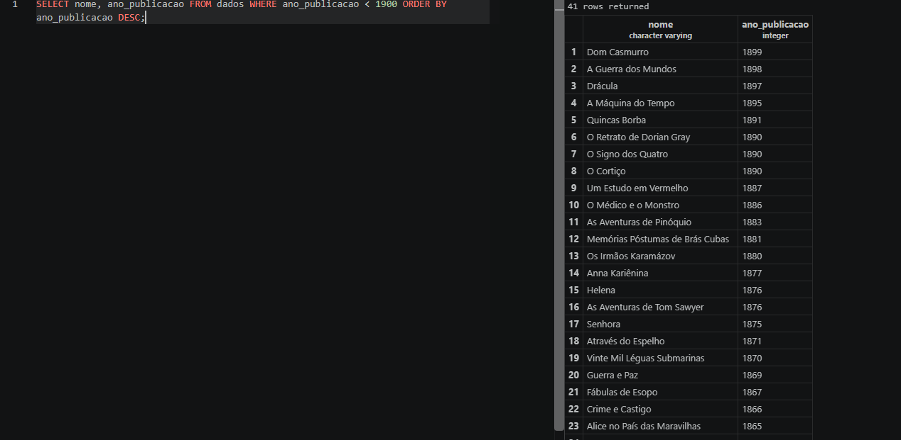

mostrando ano, livro e genero dos livros lançados ente 2010 e 2020 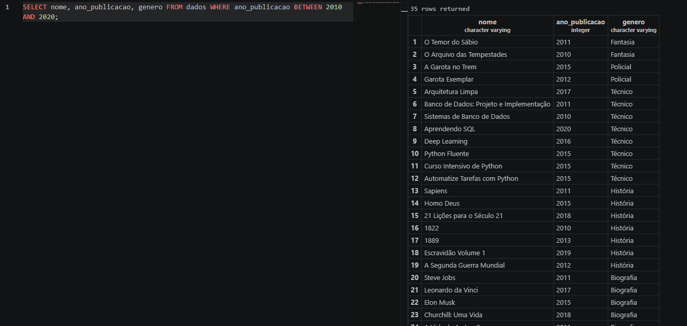