print das atividades

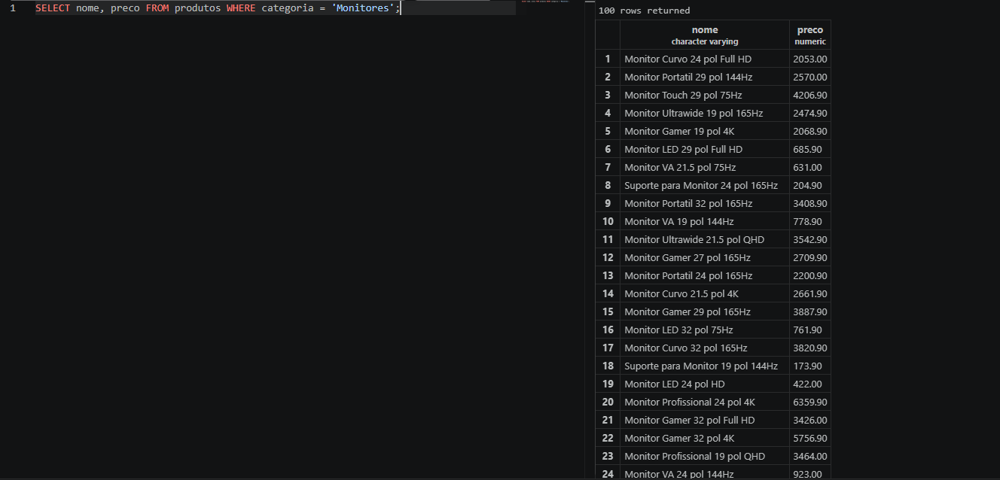

checagem estoque
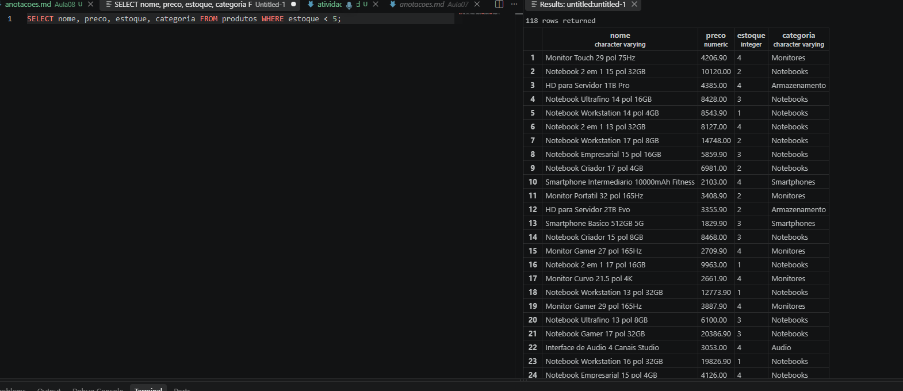

produto mais caro a barato
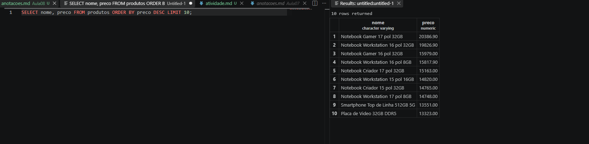

marca logitech
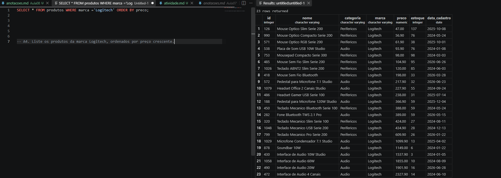

preço entre 100 e 500
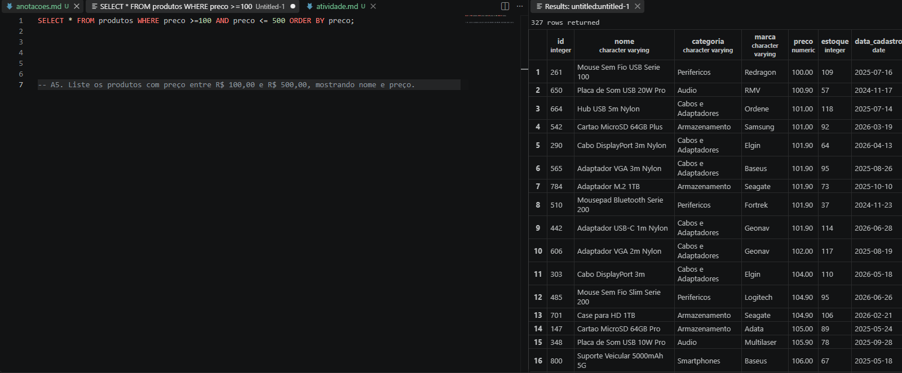

quantos tão cadastrados 
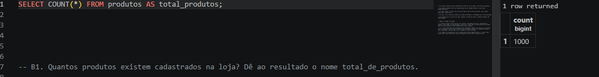

estoque menor 10 (B2)
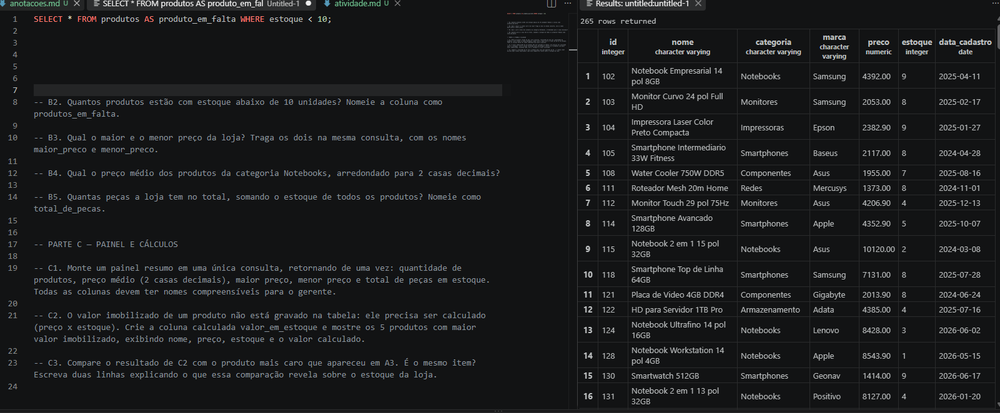

mais barato e mais caro
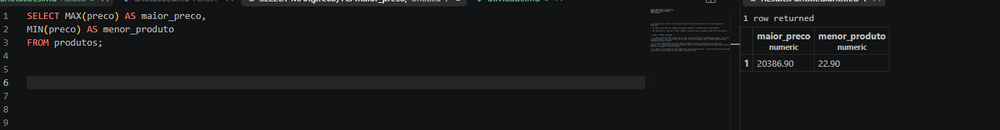

media notebooks
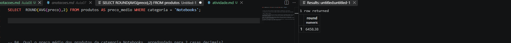

total pecas
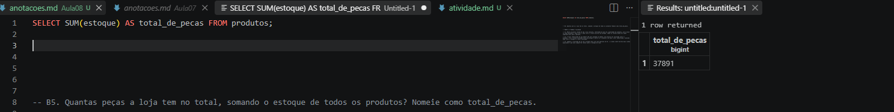

c1
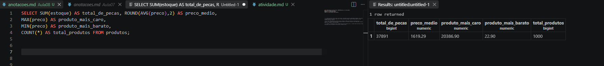

c2
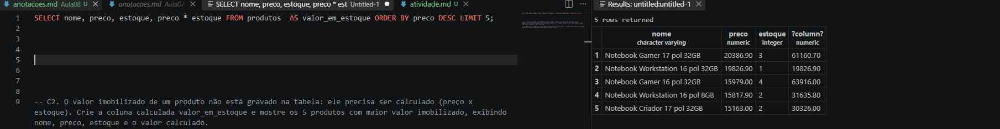

c3

revela que os produtos mais caros, por mais que não sejam os com a maior qunatidade no estoque, são aqueles com maior potencial de vendas - por mais que seja mias dificil vende-los (é mais facil vender um salgado ou um foguete nuclear)