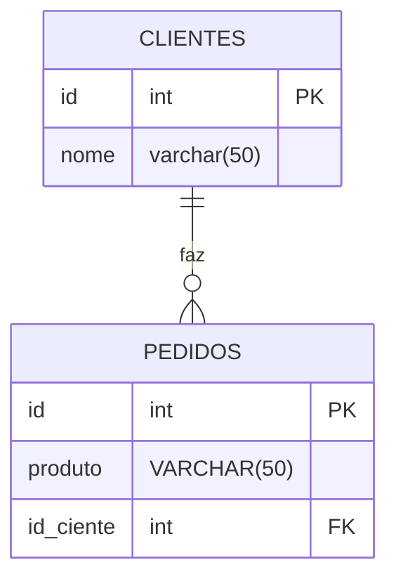

## Relacionamento entre tabelas
- Ideia principal: um cliente possui vários pedidos

## Diagrama


primeiro criar tabela
```sql
CREATE TABLE clientes(
    id SERIAL PRIMARY KEY,
    nome VARCHAR(50) NOT NULL
);
```

```sql
CREATE TABLE pedidos(
    id SERIAL PRIMARY KEY,
    produto VARCHAR(50) NOT NULL,
    id_cliente INT REFERENCES clientes(id)
);
```
references faz referencia a uma tabela
```sql
INSERT INTO clientes (nome) VALUES('Hanna'), ('Miguel'), ('Murilo'), ('Lucas');
```
coloca os clientes
```sql
INSERT INTO pedidos (produto,id_cliente) VALUES ('chocolate',3), ('Salgado', 1), ('Refri',2), ('Chocolate', 1)
```
inserir pedidos e seus respectivos clientes
```sql
SELECT clientes.nome,pedidos.produto FROM pedidos INNER JOIN clientes ON pedidos.id_cliente = clientes.id;
```
puxa a tabela dos id e quem fez o pedido

```sql
SELECT clientes.nome,pedidos.produto FROM clientes LEFT JOIN pedidos ON pedidos.id_cliente = clientes.id;
```
verifica todos, até mesmo quem não comprou nada
```sql
SELECT clientes.nome,pedidos.produto FROM clientes LEFT JOIN pedidos ON pedidos.id_cliente = clientes.id WHERE pedidos.id is null;
```
verifica quem não comprou nada

`