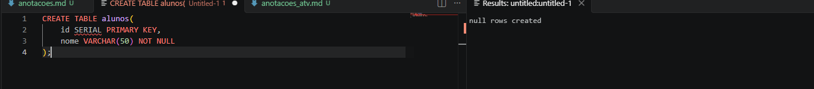
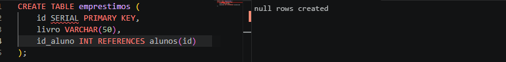
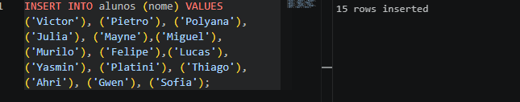
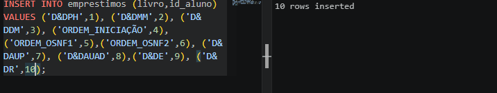
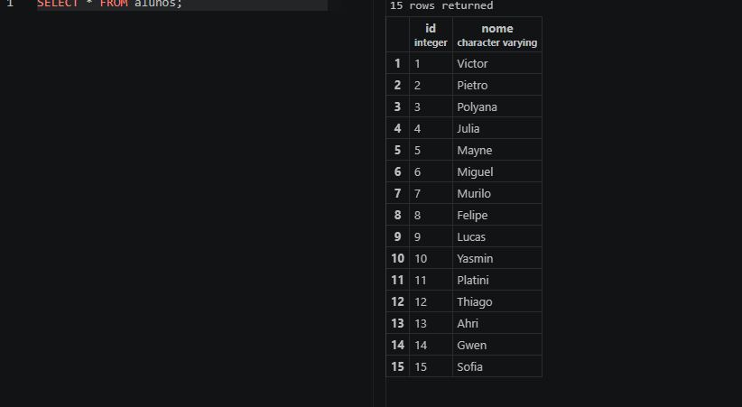
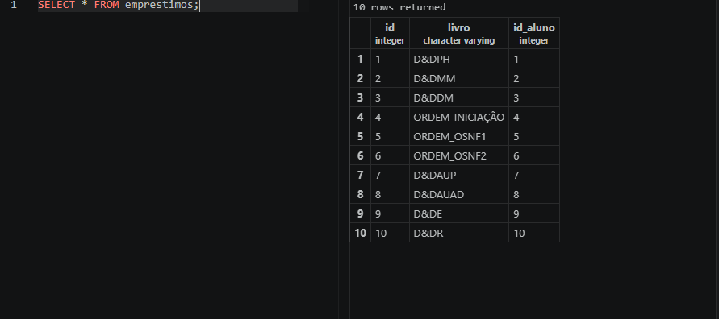
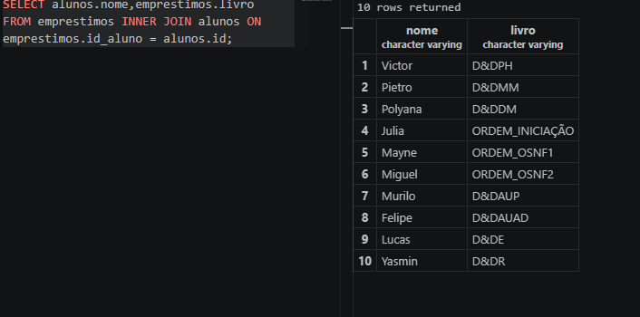
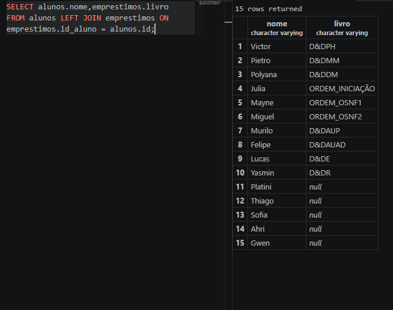
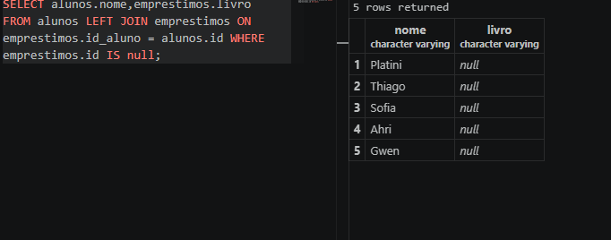
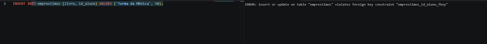

# PT2

Quem não aparece é Platini, Thiago, Ahri, Gwen e Sofia por que eles não pegaram livros

null

ele extrapola a quantidade de alunos que temos, logo ele não registra nada e retorna erro
